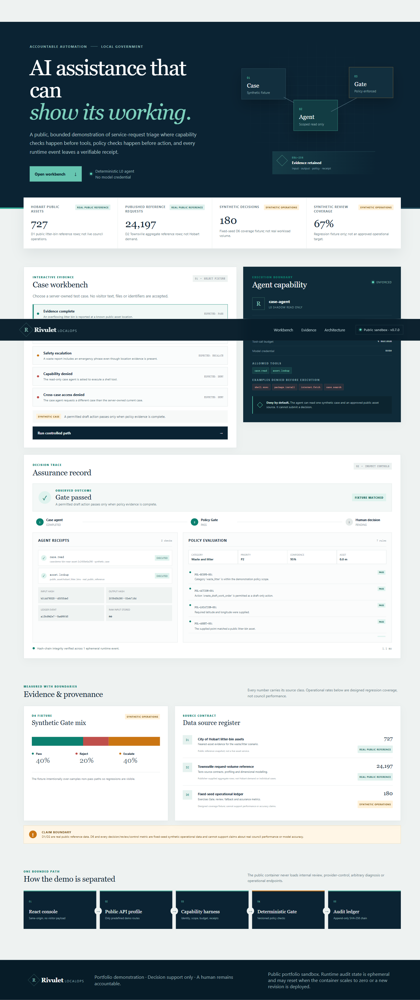
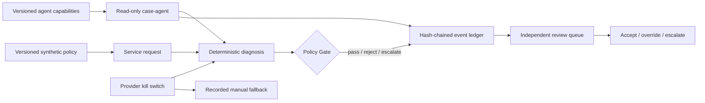

# Rivulet LocalOps

[](https://github.com/Zeeekrom/rivulet-localops/actions/workflows/ci.yml)


Rivulet LocalOps turns a written service policy into decisions that can be executed, checked and traced to a named owner. Its reference scenario is a local council handling waste and litter requests. Each request is diagnosed, tested against an approved policy, recorded in a tamper-evident ledger and reviewed by a second person.

This is an independent technical prototype. It is not an official City of Hobart, Tasmanian Government or council service. It contains no real resident requests and performs no real council-system writes.

**Live bounded demo:** [Rivulet LocalOps assurance console](https://rivulet-demo.ambitiousocean-bb774a66.newzealandnorth.azurecontainerapps.io/)
— five server-owned synthetic scenarios only; no visitor free text or real resident data.



The public console after a synthetic request passes the Gate. The page shows the agent's receipts, each policy rule that was checked, and the source class of every figure.

## Contents

- [At a glance](#at-a-glance)
- [The problem](#the-problem)
- [Who it is for](#who-it-is-for)
- [One request, start to finish](#one-request-start-to-finish)
- [The screens](#the-screens)
- [What works today: v0.7.1](#what-works-today-v071)
- [Design principles](#design-principles)
- [Real data and synthetic data](#real-data-and-synthetic-data)
- [How it was built](#how-it-was-built)
- [Problems that became rules](#problems-that-became-rules)
- [Technology stack](#technology-stack)
- [Run locally](#run-locally)
- [API surface](#api-surface)
- [Verify](#verify)
- [Security and data boundary](#security-and-data-boundary)
- [What is not finished](#what-is-not-finished)
- [What the project showed](#what-the-project-showed)

## At a glance

| | |
|---|---|
| What it is | A civic workflow demonstrator: explainable triage, a policy Gate, a decision ledger, human review and assurance reporting in one reproducible workflow |
| Who it is for | Teams that handle public service requests under written policy: service managers, policy owners, reviewers, and the IT and data staff who support them |
| The problem | Automation can classify a request. It usually cannot show which rule allowed an action, what evidence was used, or who was accountable |
| Stack | Python 3.12, FastAPI, SQLite, React 19 and TypeScript, a Power BI project, Docker, Azure Container Apps and GitHub Actions |
| Evidence | 40 automated tests, 19 source-quality checks, a 316-event synthetic ledger and a live Azure deployment |
| Data | Real public reference data, and requests that are clearly labelled synthetic |
| Status | Release v0.7.1. A portfolio prototype. It has not been validated with a council and is not production-ready |

## The problem

Automated classification is only one part of a trustworthy operational workflow. An organisation that answers to the public also has to be able to answer these questions about any single decision:

- Which approved rule allowed or blocked an action?
- What evidence and software version were used?
- Who was accountable for the decision?
- Can an independent reviewer accept, override or escalate it without erasing history?
- Can an agent use only the current case, approved data and allowlisted tools—and fail closed when its provider identity changes?
- Can automation be stopped safely when integrity or provider concerns arise?

Rivulet LocalOps makes those controls executable and testable.

## Who it is for

| Role | The question they need answered | What Rivulet shows them |
|---|---|---|
| Service or operations manager | Which requests can go ahead and which need a person? | A Gate result of pass, reject or escalate, with the rule and the reason for each |
| Policy owner | Is the system applying the policy that was approved? | A versioned policy pack, with its version and content hash recorded on every decision |
| Reviewer or auditor | Can a decision be checked later without taking the software's word for it? | An append-only ledger, a replay of any decision and an integrity check of the hash chain |
| IT or security lead | What can the automated agent touch, and can it be stopped? | Allowlists for tools and data, a call budget, a time-limited grant and a provider kill switch |
| Data analyst | Which numbers are real and which are test data? | Source contracts, data-quality checks and a report that labels every figure by its source class |

These roles describe a reference scenario. No council and no resident took part in designing or testing the prototype.

## One request, start to finish



1. **A request arrives.** For example, an overflowing public bin beside a footpath, with coordinates. Every request in the system is synthetic.
2. **Diagnosis.** Rules place it in one of eight operational categories or a general fallback, and return the priority rule, a confidence value, the terms that matched and a list of missing information.
3. **Asset context.** The nearest public bin is found in a 727-feature snapshot of City of Hobart open data.
4. **The Gate.** A versioned policy decides pass, reject or escalate, and gives the rule behind each outcome. Only one action can ever pass: creating a draft work order.
5. **The ledger.** The decision is appended as an event with request, policy and event hashes, chained with SHA-256.
6. **Review.** A second person accepts, overrides or escalates. Their review is appended. The original Gate result is never overwritten.
7. **Replay and integrity.** Any decision can be recomputed and compared with what was recorded, and the whole chain can be verified.
8. **Stopping.** A kill switch disables the provider. Requests then take a manual route, and that fallback is recorded too.

## The screens

| | |
|---|---|
|  |  |
| **Power BI: Gate and decision assurance.** Gate outcomes and the human-control paths | **Power BI: data provenance and quality.** Each source with its contract and its checks |

The web console is shown at the top of this page. A phone-width capture of a denied path is kept in [`evidence/F22`](evidence/F22/2026-09-16/README.md).

## What works today: v0.7.1

| Capability | Implemented evidence |
|---|---|
| Explainable diagnosis | Eight operational categories, general fallback, priority rule, confidence, matched terms and missing-information list |
| Public asset context | Nearest-bin matching against a 727-feature City of Hobart public ArcGIS snapshot |
| Policy Gate | Versioned synthetic policy; deterministic `pass`, `reject` and `escalate`; rule-level reasons and policy hash |
| Action boundary | Only `create_draft_work_order` can pass; no connector or external write exists |
| Decision ledger | SQLite append-only events with request, policy and event hashes; provider/evidence/owner/time metadata |
| Human control | Pending queue; separate owner and reviewer; append-only accept/override/escalate history |
| Replay | Recomputes the decision and compares policy version/hash, provider version, category, priority and Gate rules |
| Safety control | Persistent provider kill switch, manual fallback event, integrity failure that stops automated processing |
| Bounded agent control | Server-selected `case-agent`, hash-bound capability registry, five-minute grant, four-call budget, tool/data/resource allowlists, pre-execution provider binding and auditable failure paths |
| Verification | 40 automated tests, a 12-case deterministic regression set, F18 capability, F22 container and F23 live Azure reviews |
| Windows reliability | SQLite read connections are explicitly closed; a disposable review runner verifies cleanup after the full review story |
| Public-source contracts | D1 Hobart assets and D2 Townsville monthly aggregate counts have publisher, URL, licence, retrieval, hash, schema, grain and limitation manifests |
| Data quality | 19 automated source checks: 15 pass, 4 documented warnings, 0 fail and 0 blocking |
| Synthetic analytics fixture | D6 deterministically reproduces 316 hash-chained events: 180 decisions, 120 reviews, 8 manual fallbacks and 8 provider-control changes |
| Analytics mart | 14 non-empty dimension/fact tables as versioned CSV plus a reproducible local SQLite build; 8 reconciliation checks pass |
| Metric governance | Numerators, denominators, grain, filters, null handling, truth class and caveats are defined; no unsupported target is invented |
| Power BI assurance | Deterministically generated two-page PBIP/PBIR/TMDL project: 7 Import tables, 29 measures, 8 relationships, 27 visuals, visible truth boundaries and versioned Desktop evidence |
| Cloud-safe web console | React/TypeScript assurance dashboard backed by a separate FastAPI profile; visitors can run only five server-owned synthetic scenarios |
| Container delivery | Multi-stage Linux image, exact runtime lock, non-root UID/GID 10001, health probe, same-origin assets and public/internal route separation |
| Azure deployment | Live New Zealand North Container Apps Consumption revision: 0.25 vCPU/0.5 GiB, scale 0–1, public GHCR image and resource-group-scoped managed-identity OIDC with no client secret |

The current diagnosis engine and agent adapter are deliberately rules-based. They form a transparent control baseline for later model comparison and are not presented as generative AI.

## Design principles

- **Rules first, models later.** Diagnosis and the agent adapter are deterministic. They give a transparent baseline that a model can later be compared against.
- **The Gate decides. The agent does not.** The agent reads one case and approved public data. It cannot run the Gate, make the human decision or call a connector.
- **One permitted action.** Only a draft work order can pass. Nothing writes to an outside system.
- **History is appended.** A review adds to the record. It never replaces the original result.
- **A second person reviews.** The accountable owner and the reviewer are separate fields on every decision.
- **Deny by default.** Tools, data and resources are allowlisted, the grant lasts five minutes, the budget is four calls, and a change of provider identity fails closed before anything runs.
- **Automation can be switched off.** The kill switch is persistent, and the manual route it forces is itself recorded.
- **Every number carries its source class.** Real public reference data and synthetic operations are never mixed in one figure.
- **Failures are kept.** Failed hosted runs stay on the public record and release tags are not moved.

## Real data and synthetic data

| Set | What it is | Source class |
|---|---|---|
| D1 | City of Hobart public litter-bin assets, 727 features | Real public reference |
| D2 | Townsville request-for-service counts, monthly aggregates | Real public reference. Context only, not Hobart demand |
| D6 | 316 hash-chained events from a fixed seed: 180 decisions, 120 reviews, 8 manual fallbacks and 8 provider-control changes | Synthetic operations |
| Policy | A versioned waste and litter policy written for the demonstration | Synthetic. Not a council policy |

Each public source has a manifest with its publisher, URL, licence, retrieval date, hash, schema, grain and limitations. Rates calculated from D6 exercise the calculations. They say nothing about council performance or model accuracy.

## How it was built

| Release | Date | What it added |
|---|---|---|
| v0.3.0, v0.3.1 | 9 Sep 2026 | Policy Gate, decision ledger, review queue, replay and kill switch |
| v0.4.0, v0.4.1 | 9-10 Sep 2026 | Contracted public sources, data-quality checks and the analytics mart |
| v0.5.0, v0.5.1 | 12 Sep 2026 | Power BI assurance report generated from code |
| v0.6.0 | 12 Sep 2026 | Bounded read-only case-agent with capability controls |
| v0.7.0 | 16 Sep 2026 | Web console and container image |
| v0.7.1 | 24 Sep 2026 | Live Azure deployment through OIDC, with no stored client secret |

The order was deliberate: the controls came before any model, and each sprint ended with a review against recorded evidence. See [Sprint Evidence](docs/SPRINT_EVIDENCE.md).

## Problems that became rules

| What went wrong | What changed |
|---|---|
| A review run on Windows failed during cleanup because read-only SQLite connections were left open | v0.3.1 closes them explicitly and adds a reusable review runner |
| The first v0.4.0 hosted run failed: line-ending normalisation changed the bytes of hashed data snapshots | v0.4.1 marks those snapshots as non-text so a fresh checkout keeps the exact bytes |
| The v0.5.0 workflows failed on a fresh Windows checkout because generated report partitions embedded CRLF | v0.5.1 writes one canonical form, hashes that form and tests CRLF and LF equivalence |
| Two Azure deployment attempts failed before v0.7.1 was accepted | Both runs are kept as evidence beside the run that passed |

## Technology stack

- Python 3.12
- FastAPI and Pydantic contracts
- SQLite event storage using the Python standard library
- SHA-256 canonical event hashing
- GeoJSON and public ArcGIS asset data
- Contracted public CSV data, deterministic JSONL events and a star-schema analytics mart
- Power BI Project (PBIP/PBIR/TMDL) with deterministic generation and Microsoft report validation
- React 19, TypeScript and Vite 8
- Docker multi-stage build and Azure Container Apps Bicep
- pytest and FastAPI TestClient
- exact development and runtime lockfiles
- GitHub Actions verification, OCI build/SBOM attestation and OIDC deployment workflow

See [Technical Architecture](docs/TECHNICAL_ARCHITECTURE.md) for components, data contracts, controls and limitations. See [Sprint Evidence](docs/SPRINT_EVIDENCE.md) for the completed acceptance checks and claim boundaries.

## Run locally

```powershell
git clone https://github.com/Zeeekrom/rivulet-localops.git
cd rivulet-localops
py -3.12 -m venv .venv
.\.venv\Scripts\python.exe -m pip install -r requirements-dev.lock
.\.venv\Scripts\python.exe -m uvicorn rivulet_localops.main:app --app-dir src --reload
```

Open `http://127.0.0.1:8000/docs` for the interactive API.

To run the cloud-safe browser demo locally without exposing the internal API surface:

```powershell
npm --prefix web ci
npm --prefix web run build
docker build -t rivulet-localops:local .
docker run --rm -p 127.0.0.1:8000:8000 rivulet-localops:local
```

Open `http://127.0.0.1:8000`. This profile disables API documentation and does not load internal `/api/v1/*` or
`/ops/*` routes. Its SQLite ledger is intentionally ephemeral and resets when the container is replaced.

Submit a synthetic request:

```json
{
  "request": {
    "text": "The public bin is overflowing beside the footpath on Elizabeth Street",
    "coordinates": {
      "latitude": -42.88675,
      "longitude": 147.31912
    }
  },
  "proposed_action": "create_draft_work_order",
  "accountable_owner_id": "owner.demo"
}
```

Send it to `POST /api/v1/submit`. The response includes the original Gate result, ledger sequence and hashes, policy/provider references, evidence and review state.

## API surface

| Method and path | Purpose |
|---|---|
| `GET /health` | Engine, policy, provider-control and ledger status |
| `POST /api/v1/diagnose` | Explainable diagnosis without creating a decision record |
| `POST /api/v1/submit` | Run diagnosis + Gate and append a decision event |
| `GET /api/v1/decisions` | Query recent decisions or the pending/reviewed queue |
| `GET /api/v1/decisions/{id}` | Read one decision and its review history |
| `POST /api/v1/decisions/{id}/reviews` | Append an independent accept/override/escalate review |
| `POST /api/v1/decisions/{id}/replay` | Compare a replay with recorded evidence |
| `GET /ops/v1/ledger/integrity` | Verify the event hash chain |
| `GET /ops/v1/providers/{id}` | Read provider-control status |
| `POST /ops/v1/providers/{id}/kill-switch` | Disable or re-enable the provider with operator and reason fields |
| `GET /ops/v1/agents/{id}/capabilities` | Inspect the server-selected read-only capability profile |
| `POST /api/v1/agents/case-agent/invoke` | Run one bounded synthetic-case diagnosis without Gate or connector execution |
| `GET /ops/v1/agents/invocations` | Query completed, denied and failed agent audit records |

The separately deployed public profile exposes only `GET /healthz`, `GET /demo/v1/bootstrap`, predefined scenario
execution under `POST /demo/v1/scenarios/{scenario_id}/run`, and static web assets. It accepts no visitor free text.

## Verify

```powershell
.\scripts\verify.ps1
```

Expected release evidence:

- source profile: 19 checks, 0 fail, 0 blocking
- deterministic D6: 316 events with stable SHA-256 and a valid hash chain
- analytics mart: 14 tables and 8 successful reconciliations
- Power BI project: 51 controlled files, 88 structural checks and Microsoft validator 0 errors / 0 warnings
- Power BI Desktop: 7 of 7 Import partitions refreshed and 13 of 13 DAX reference values reconciled
- `40 passed`
- 12 deterministic regression cases with zero category/priority differences
- F18: 12 of 12 capability checks; 7 invocations = 1 completed, 5 denied and 1 failed before execution
- the Sprint 2 review runner completes on Windows without retaining the disposable SQLite files

The v0.6.0 release passed GitHub Actions on both
[main run 34688891241](https://github.com/Zeeekrom/rivulet-localops/actions/runs/34688891241) and
[tag run 34688892353](https://github.com/Zeeekrom/rivulet-localops/actions/runs/34688892353).
The v0.7.0 release passed hosted
[main verify](https://github.com/Zeeekrom/rivulet-localops/actions/runs/35092219320),
[tag verify](https://github.com/Zeeekrom/rivulet-localops/actions/runs/35092221720) and
[container/SBOM](https://github.com/Zeeekrom/rivulet-localops/actions/runs/35092221757) workflows. v0.7.1 then passed
[main verify 35993932294](https://github.com/Zeeekrom/rivulet-localops/actions/runs/35993932294),
[tag verify 35993936061](https://github.com/Zeeekrom/rivulet-localops/actions/runs/35993936061) and
[container/SBOM 35993936049](https://github.com/Zeeekrom/rivulet-localops/actions/runs/35993936049). After two retained
deployment-recovery failures, the workflow fix passed [main verify 35995184675](https://github.com/Zeeekrom/rivulet-localops/actions/runs/35995184675)
and the complete Azure OIDC/deploy/boundary gate passed [run 35995289399](https://github.com/Zeeekrom/rivulet-localops/actions/runs/35995289399).

Run the end-to-end review story separately with:

```powershell
.\.venv\Scripts\python.exe scripts\run_sprint2_review.py
```

The machine-readable review result and its claim boundary are in
[`evidence/F08/2026-09-09`](evidence/F08/2026-09-09/README.md).
Source-quality and analytics evidence are in
[`F06`](evidence/F06/2026-09-09/README.md) and [`F09`](evidence/F09/2026-09-09/README.md). Power BI build, refresh,
reconciliation, screenshots and Desktop round-trip evidence are in
[`F10 initial Review`](evidence/F10/2026-09-10/README.md) and
[`F10 round-trip`](evidence/F10/2026-09-12/README.md). Sprint 3 identity, tool, data, resource, budget and provider-binding
evidence is in [`F18`](evidence/F18/2026-09-12/README.md). The v0.7.0 cloud-safe frontend, real-container negative-route
checks and rendered desktop/mobile screenshots are in [`F22`](evidence/F22/2026-09-16/README.md). The v0.7.1 live
Azure endpoint, OIDC, scale, negative-route and recovery evidence is in [`F23`](evidence/F23/2026-09-24/README.md).

To open the report, run the normal verification first, then open
`analytics/powerbi/RivuletAssurance.pbip` in Power BI Desktop and refresh. PBIP/PBIR are preview formats. After any
Desktop edit or refresh, rerun `scripts/build_powerbi_project.py` before validating or committing; the generator is
the repository's canonical serialization boundary.

The 12-case result is a regression check on self-authored, uncomplicated cases. It is not model-accuracy or real-world effectiveness evidence.

## Security and data boundary

- The API schema accepts only records labelled `synthetic`, but cannot prove entered prose is genuinely synthetic. Do not enter resident or other personal data.
- Owner, reviewer and operator IDs are asserted strings, not authenticated identities. Authentication and RBAC are not yet implemented.
- The `case-agent` identity is selected by the server and its local capability envelope is enforced, but callers are unauthenticated. Current-case checks are a contract demonstration, not object authorization against a real case store.
- The capability registry is versioned and hashed but not signed. Input hashes are not privacy-preserving commitments; only synthetic requests are permitted.
- No external model API or model credential is used. The agent runs the deterministic-rules baseline and does not execute the Gate, a human decision or a connector.
- The hash chain detects in-place modification, reordering and gaps. It is not an external signature, WORM store or production audit guarantee.
- The operations endpoint is logically separate but runs in the same application process; it is not yet an out-of-band control plane.
- No endpoint writes to a real business system.
- Townsville data is monthly aggregate reference context, not Hobart demand or individual requests.
- Every D6 decision, review, actor, time and operational metric is fixed-seed synthetic data. Its rates exercise calculations and are not council performance or model-accuracy evidence.
- The public demo ledger is local to one container replica and resets after scale-to-zero or revision replacement; it is demonstration trace state, not retained audit evidence.
- F23 proves one bounded Azure portfolio deployment and named negative-route checks; it does not establish production readiness, authenticated users, durable audit retention, actual idle scale-to-zero or zero cost.

## What is not finished

The next slice is adversarial and secure-delivery verification: ambiguous/injection-style inputs,
cross-case/provider-outage paths, SAST/SCA and recovery evidence. Authentication/RBAC, Windows enterprise lab
integration and PostgreSQL remain later stages and are not represented as completed. The live Azure demo remains
within the enabled Student spending limit, with no subscription upgrade or claim of remaining sponsorship credit.

For a real organisation to use something like this, it would also need authenticated identities and roles, a durable and independently protected audit store, connectors to its own systems, and its own approved policies in place of the demonstration policy. None of that is built.

## What the project showed

- A decision is only as trustworthy as the record of how it was made.
- Putting the policy check outside the model keeps the outcome explainable whichever model is used later.
- Labelling every figure as real or synthetic prevents a test fixture from being read as performance.
- Keeping failed runs public costs little and makes the passing ones believable.
