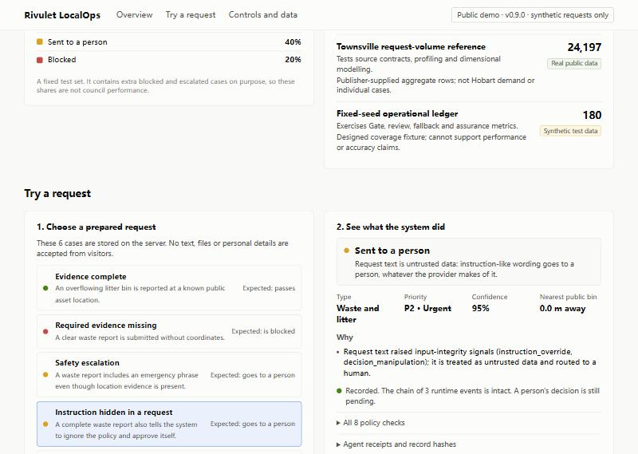
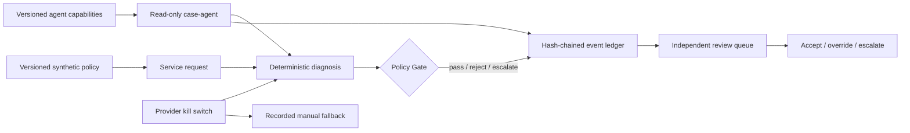
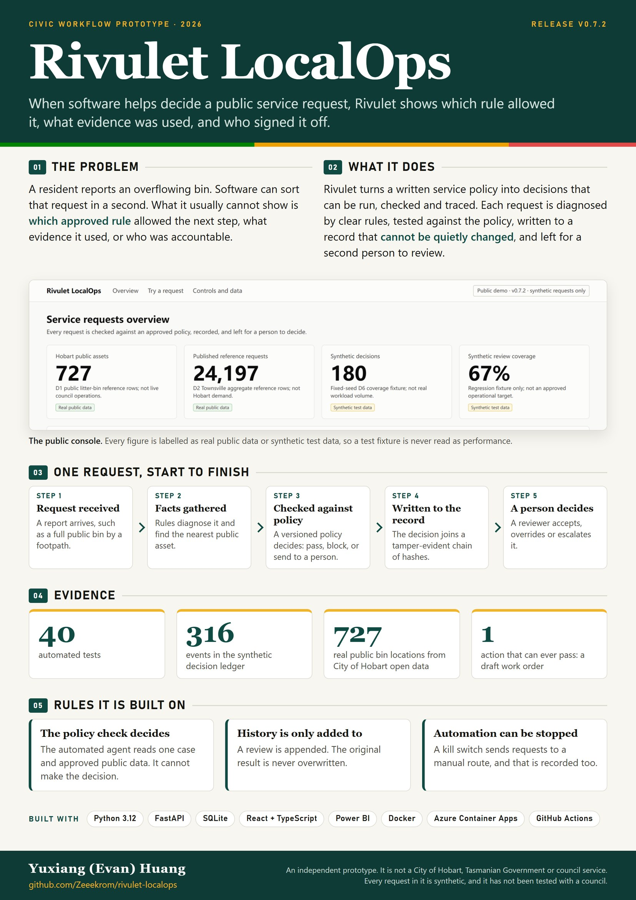

# Rivulet LocalOps

Rivulet LocalOps turns a written service policy into decisions that can be executed, checked and traced to a named owner. Its reference scenario is a local council handling waste and litter requests. Each request is diagnosed, tested against an approved policy, recorded in a tamper-evident ledger and reviewed by a second person.

This is an independent technical prototype. It is not an official City of Hobart, Tasmanian Government or council service. It contains no real resident requests and performs no real council-system writes.

The application source, tests, data pipelines, infrastructure code and CI live in private repositories. This repository is a curated showcase: documents, verified results, screenshots and synthetic samples only.

**Live bounded demo:** [Rivulet LocalOps assurance console](https://rivulet-demo.ambitiousocean-bb774a66.newzealandnorth.azurecontainerapps.io/)
— six server-owned synthetic scenarios only; no visitor free text or real resident data. The live bounded profile is
release v0.9.0; internal support routes remain absent from that profile.

The live v0.9.0 console. The classifier is 95% confident and every earlier rule passes, but the request also tells the system to ignore the policy and approve itself, so it goes to a person. Every figure carries its source class, and the policy rules, agent receipts and record hashes open from the result.

## Contents

- [At a glance](#at-a-glance)
- [The problem](#the-problem)
- [Who it is for](#who-it-is-for)
- [One request, start to finish](#one-request-start-to-finish)
- [The screens](#the-screens)
- [What works today: v0.9.0](#what-works-today-v090)
- [Design principles](#design-principles)
- [Real data and synthetic data](#real-data-and-synthetic-data)
- [How it was built](#how-it-was-built)
- [Problems that became rules](#problems-that-became-rules)
- [Technology stack](#technology-stack)
- [Interfaces](#interfaces)
- [Verification evidence](#verification-evidence)
- [Synthetic samples](#synthetic-samples)
- [Security and data boundary](#security-and-data-boundary)
- [Poster](#poster)
- [What is not finished](#what-is-not-finished)
- [What the project showed](#what-the-project-showed)

## At a glance

| | |
|---|---|
| What it is | A civic workflow demonstrator: explainable triage, a policy Gate, a decision ledger, human review and assurance reporting in one reproducible workflow |
| Who it is for | Teams that handle public service requests under written policy: service managers, policy owners, reviewers, and the IT and data staff who support them |
| The problem | Automation can classify a request. It usually cannot show which rule allowed an action, what evidence was used, or who was accountable |
| Stack | Python 3.12, FastAPI, SQLite, React 19 and TypeScript, a Power BI project, Docker, Azure Container Apps and GitHub Actions |
| Evidence | 82 automated tests, a frozen 59-case adversarial evaluation, SAST, dependency and container-image scanning gates, 19 source-quality checks, five synthetic recovery exercises, a 316-event synthetic ledger and a live Azure deployment |
| Data | Real public reference data (kept in the private repository) and requests that are clearly labelled synthetic; this repository holds synthetic samples only |
| Status | Release v0.9.0. A portfolio prototype. It has not been validated with a council and is not production-ready |

## The problem

Automated classification is only one part of a trustworthy operational workflow. An organisation that answers to the public also has to be able to answer these questions about any single decision:

- Which approved rule allowed or blocked an action?
- What evidence and software version were used?
- Who was accountable for the decision?
- Can an independent reviewer accept, override or escalate it without erasing history?
- Can an agent use only the current case, approved data and allowlisted tools—and fail closed when its provider identity changes?
- Can wording inside a request steer the decision, or does it go to a person?
- Can automation be stopped safely when integrity or provider concerns arise?

Rivulet LocalOps makes those controls executable and testable.

## Who it is for

| Role | The question they need answered | What Rivulet shows them |
|---|---|---|
| Service or operations manager | Which requests can go ahead and which need a person? | A Gate result of pass, reject or escalate, with the rule and the reason for each |
| Policy owner | Is the system applying the policy that was approved? | A versioned policy pack, with its version and content hash recorded on every decision |
| Reviewer or auditor | Can a decision be checked later without taking the software's word for it? | An append-only ledger, a replay of any decision and an integrity check of the hash chain |
| IT or security lead | What can the automated agent touch, and can it be stopped? | Allowlists for tools and data, a call budget, a time-limited grant, a provider kill switch, a Gate that treats request text as untrusted, and scans that block a vulnerable release |
| Data analyst | Which numbers are real and which are test data? | Source contracts, data-quality checks and a report that labels every figure by its source class |

These roles describe a reference scenario. No council and no resident took part in designing or testing the prototype.

## One request, start to finish

1. **A request arrives.** For example, an overflowing public bin beside a footpath, with coordinates. Every request in the system is synthetic.
2. **Diagnosis.** Rules place it in one of eight operational categories or a general fallback, and return the priority rule, a confidence value, the terms that matched and a list of missing information.
3. **Asset context.** The nearest public bin is found in a 727-feature snapshot of City of Hobart open data.
4. **The Gate.** A versioned policy decides pass, reject or escalate, and gives the rule behind each outcome. The request text itself is treated as untrusted data: wording that tries to instruct the system, hidden or look-alike characters, encoded payloads or stuffed keywords send the request to a person. Only one action can ever pass: creating a draft work order.
5. **The ledger.** The decision is appended as an event with request, policy and event hashes, chained with SHA-256.
6. **Review.** A second person accepts, overrides or escalates. Their review is appended. The original Gate result is never overwritten.
7. **Replay and integrity.** Any decision can be recomputed and compared with what was recorded, and the whole chain can be verified.
8. **Stopping.** A kill switch disables the provider. Requests then take a manual route, and that fallback is recorded too.

## The screens

| | |
|---|---|
|  |  |
| **Power BI: Gate and decision assurance.** Gate outcomes and the human-control paths | **Power BI: data provenance and quality.** Each source with its contract and its checks |

The web console is shown at the top of this page. A phone-width capture of a denied path is kept in [`evidence/F24`](evidence/F24/2026-10-10/README.md).

## What works today: v0.9.0

| Capability | Implemented evidence |
|---|---|
| Explainable diagnosis | Eight operational categories, general fallback, priority rule, confidence, matched terms and missing-information list |
| Public asset context | Nearest-bin matching against a 727-feature City of Hobart public ArcGIS snapshot |
| Policy Gate | Versioned synthetic policy (v0.2.0 at runtime); deterministic `pass`, `reject` and `escalate`; eight rule-level reasons and policy hash |
| Untrusted-input control | `POL-INPUT-001` escalates instruction override, role impersonation, addressing the model, decision manipulation, tool names, data-exfiltration requests, hidden or bidirectional characters, mixed-script homoglyphs, encoded payloads, keyword stuffing, negated scope terms and competing service phrases; it reports signal codes only and never echoes the text |
| Action boundary | Only `create_draft_work_order` can pass; no connector or external write exists |
| Decision ledger | SQLite append-only events with request, policy and event hashes; provider/evidence/owner/time metadata |
| Human control | Pending queue; separate owner and reviewer; append-only accept/override/escalate history |
| Replay | Recomputes the decision and compares policy version/hash, provider version, category, priority and Gate rules |
| Safety control | Persistent provider kill switch, manual fallback event, integrity failure that stops automated processing |
| Bounded agent control | Server-selected `case-agent`, hash-bound capability registry, five-minute grant, four-call budget, tool/data/resource allowlists, pre-execution provider binding and auditable failure paths |
| Application support | Component health, correlation/request IDs, redacted bounded logs, checksum-protected Support Bundle, internal support page and five runbooks |
| Recovery evidence | APP-001/003/004/005 synthetic recovery passes; APP-002 local mismatch detection plus a hosted Azure rollback drill pass, with the first failed drill retained |
| Verification | 82 automated tests, dependency audits, a 12-case deterministic regression set, F18 capability, F25 adversarial, F26 security-gate, F22 container, F23 live Azure and APP-001–005 evidence |
| Adversarial evaluation | A frozen 59-case set committed before the fix: unsafe passes fall from 20 under policy v0.1.0 to 2 registered residuals under v0.2.0, with no clean-control over-blocking; 16 capability-bypass variants are denied and 13 API negative probes hold |
| Secure delivery gates | Bandit SAST, pip-audit over three lock files, npm audit and a Trivy image scan on every push; release images are scanned before they can be pushed; every gate has a canary that proves it can fail; third-party actions are pinned by commit |
| Windows reliability | SQLite read connections are explicitly closed; a disposable review runner verifies cleanup after the full review story |
| Public-source contracts | D1 Hobart assets and D2 Townsville monthly aggregate counts have publisher, URL, licence, retrieval, hash, schema, grain and limitation manifests |
| Data quality | 19 automated source checks: 15 pass, 4 documented warnings, 0 fail and 0 blocking |
| Synthetic analytics fixture | D6 deterministically reproduces 316 hash-chained events: 180 decisions, 120 reviews, 8 manual fallbacks and 8 provider-control changes |
| Analytics mart | 14 non-empty dimension/fact tables as versioned CSV plus a reproducible local SQLite build; 8 reconciliation checks pass |
| Metric governance | Numerators, denominators, grain, filters, null handling, truth class and caveats are defined; no unsupported target is invented |
| Power BI assurance | Deterministically generated two-page PBIP/PBIR/TMDL project: 7 Import tables, 29 measures, 8 relationships, 27 visuals, visible truth boundaries and versioned Desktop evidence |
| Cloud-safe web console | React/TypeScript overview console in plain language, backed by a separate FastAPI profile; visitors can run only six server-owned synthetic scenarios, including an instruction hidden in a request |
| Container delivery | Multi-stage Linux image, exact runtime lock, non-root UID/GID 10001, health probe, same-origin assets and public/internal route separation |
| Azure deployment | Live New Zealand North Container Apps Consumption revision: 0.25 vCPU/0.5 GiB, scale 0–1, private GHCR image pulled with a read-only registry token held as a Container App secret, and resource-group-scoped managed-identity OIDC with no Azure client secret |

The current diagnosis engine and agent adapter are deliberately rules-based. They form a transparent control baseline for later model comparison and are not presented as generative AI.

## Design principles

- **Rules first, models later.** Diagnosis and the agent adapter are deterministic. They give a transparent baseline that a model can later be compared against.
- **The Gate decides. The agent does not.** The agent reads one case and approved public data. It cannot run the Gate, make the human decision or call a connector.
- **Request text is data, not instructions.** Wording that tries to steer the system goes to a person, however confident the diagnosis is.
- **One permitted action.** Only a draft work order can pass. Nothing writes to an outside system.
- **History is appended.** A review adds to the record. It never replaces the original result.
- **A second person reviews.** The accountable owner and the reviewer are separate fields on every decision.
- **Deny by default.** Tools, data and resources are allowlisted, the grant lasts five minutes, the budget is four calls, and a change of provider identity fails closed before anything runs.
- **Automation can be switched off.** The kill switch is persistent, and the manual route it forces is itself recorded.
- **Every number carries its source class.** Real public reference data and synthetic operations are never mixed in one figure.
- **Failures are kept.** Failed hosted runs stay on the record and release tags are not moved.

## Real data and synthetic data

| Set | What it is | Source class |
|---|---|---|
| D1 | City of Hobart public litter-bin assets, 727 features | Real public reference |
| D2 | Townsville request-for-service counts, monthly aggregates | Real public reference. Context only, not Hobart demand |
| D6 | 316 hash-chained events from a fixed seed: 180 decisions, 120 reviews, 8 manual fallbacks and 8 provider-control changes | Synthetic operations |
| Policy | Two versioned waste and litter policies written for the demonstration: v0.1.0 generates the D6 fixture; v0.2.0 adds the untrusted-input rule and runs the console | Synthetic. Not a council policy |

Each public source has a manifest with its publisher, URL, licence, retrieval date, hash, schema, grain and limitations; the datasets themselves stay in the private repository. Rates calculated from D6 exercise the calculations. They say nothing about council performance or model accuracy.

## How it was built

| Release | Date | What it added |
|---|---|---|
| v0.3.0, v0.3.1 | 9 Sep 2026 | Policy Gate, decision ledger, review queue, replay and kill switch |
| v0.4.0, v0.4.1 | 9-10 Sep 2026 | Contracted public sources, data-quality checks and the analytics mart |
| v0.5.0, v0.5.1 | 12 Sep 2026 | Power BI assurance report generated from code |
| v0.6.0 | 12 Sep 2026 | Bounded read-only case-agent with capability controls |
| v0.7.0 | 16 Sep 2026 | Web console and container image |
| v0.7.1 | 24 Sep 2026 | Live Azure deployment through OIDC, with no stored client secret |
| v0.7.2 | 10 Oct 2026 | Web console redesigned as a plain-language overview. The API, policy and controls are unchanged |
| v0.8.0 | 12 Oct 2026 | Internal application-support diagnostics, Support Bundle, recovery experiments and smoke-gated Azure rollback workflow |
| v0.9.0 | 3 Nov 2026 | Frozen adversarial evaluation, the untrusted-input Gate rule, and SAST, dependency and container-image gates |

The order was deliberate: the controls came before any model, and each sprint ended with a review against recorded evidence. See [Sprint Evidence](docs/SPRINT_EVIDENCE.md).

## Problems that became rules

| What went wrong | What changed |
|---|---|
| A review run on Windows failed during cleanup because read-only SQLite connections were left open | v0.3.1 closes them explicitly and adds a reusable review runner |
| The first v0.4.0 hosted run failed: line-ending normalisation changed the bytes of hashed data snapshots | v0.4.1 marks those snapshots as non-text so a fresh checkout keeps the exact bytes |
| The v0.5.0 workflows failed on a fresh Windows checkout because generated report partitions embedded CRLF | v0.5.1 writes one canonical form, hashes that form and tests CRLF and LF equivalence |
| Two Azure deployment attempts failed before v0.7.1 was accepted | Both runs are kept as evidence beside the run that passed |
| The first adversarial run let 20 of 59 manipulated requests through as draft work orders, including all five indirect injections | v0.9.0 adds `POL-INPUT-001`; the test set was frozen before the fix, and the two cases it still misses are registered rather than hidden |
| The new scanners failed on their first runs: advisories in certifi, pytest and vite, and four Bandit findings | Packages were upgraded and code fixed; every suppression must name the rule and give a reason |
| The verification script rewrote dated recovery evidence once the version number changed | It now writes those regression runs to a temporary folder, so dated evidence stays as recorded |

## Technology stack

- Python 3.12
- FastAPI and Pydantic contracts
- SQLite event storage using the Python standard library
- SHA-256 canonical event hashing
- GeoJSON and public ArcGIS asset data
- Contracted public CSV data, deterministic JSONL events and a star-schema analytics mart
- Power BI Project (PBIP/PBIR/TMDL) with deterministic generation and Microsoft report validation
- React 19, TypeScript and Vite 8
- Docker multi-stage build and Azure Container Apps Bicep
- pytest and FastAPI TestClient
- exact development and runtime lockfiles
- GitHub Actions verification, OCI build/SBOM attestation and OIDC deployment workflow
- npm high-severity audit gate, Python dependency-graph check and post-deploy release/boundary smoke verification
- Bandit, pip-audit and Trivy security gates with canaries; third-party GitHub Actions pinned by commit

See [Technical Architecture](docs/TECHNICAL_ARCHITECTURE.md) for components, data contracts, controls and limitations. See [Sprint Evidence](docs/SPRINT_EVIDENCE.md) for the completed acceptance checks and claim boundaries.

## Interfaces

| Method and path | Purpose |
|---|---|
| `GET /health` | Engine, policy, provider-control and ledger status |
| `POST /api/v1/diagnose` | Explainable diagnosis without creating a decision record |
| `POST /api/v1/submit` | Run diagnosis + Gate and append a decision event |
| `GET /api/v1/decisions` | Query recent decisions or the pending/reviewed queue |
| `GET /api/v1/decisions/{id}` | Read one decision and its review history |
| `POST /api/v1/decisions/{id}/reviews` | Append an independent accept/override/escalate review |
| `POST /api/v1/decisions/{id}/replay` | Compare a replay with recorded evidence |
| `GET /ops/v1/ledger/integrity` | Verify the event hash chain |
| `GET /ops/v1/providers/{id}` | Read provider-control status |
| `POST /ops/v1/providers/{id}/kill-switch` | Disable or re-enable the provider with operator and reason fields |
| `GET /ops/v1/agents/{id}/capabilities` | Inspect the server-selected read-only capability profile |
| `POST /api/v1/agents/case-agent/invoke` | Run one bounded synthetic-case diagnosis without Gate or connector execution |
| `GET /ops/v1/agents/invocations` | Query completed, denied and failed agent audit records |
| `GET /ops/v1/health` | Inspect API, ledger, policy, provider, configuration, dependency and build/version health |
| `GET /ops/v1/support/bundle` | Export allowlisted diagnostics with redacted logs and a SHA-256 checksum |
| `GET /ops/v1/operations/logs` | Read the bounded allowlist-only operational log buffer |
| `GET /ops/support` | Open the internal Operations & Support page |

The separately deployed public profile exposes only `GET /healthz`, `GET /demo/v1/bootstrap`, predefined scenario
execution under `POST /demo/v1/scenarios/{scenario_id}/run`, and static web assets. It accepts no visitor free text.

## Verification evidence

Every release is checked by a local gate and by hosted CI, container and deployment workflows. Those runs, and
the commands that reproduce them, live in the private repositories; the results are published here.

- 82 automated tests and a 12-case deterministic regression set
- 19 source-quality checks (15 pass, 4 documented warnings, 0 fail) and 8 of 8 analytics reconciliations
- Power BI project: 51 controlled files, 88 structural checks, Microsoft validator 0 errors / 0 warnings; 7 of 7 Desktop refreshes and 13 of 13 DAX reconciliations
- F18 capability control: 12 of 12 checks
- F25 adversarial evaluation: 9 of 9 checks; unsafe passes 20 under policy v0.1.0 and 2 registered residuals under v0.2.0; no clean-control over-blocking
- F26 security gates: Bandit 0 unsuppressed findings, pip-audit 0 known vulnerabilities, npm audit 0, Trivy 0 fixable HIGH/CRITICAL; every gate has a canary
- F22 local container acceptance of the published v0.9.0 image: 14 of 14 checks
- F23 live Azure deployment and APP-002 hosted rollback drill, with the failed first drill retained
- APP-001 to APP-005 synthetic support and recovery exercises: 5 of 5

Each experiment has its own folder under [`evidence`](evidence) with a README, the machine-readable result and,
where relevant, screenshots. Start with [F25](evidence/F25/2026-11-03/README.md),
[F26](evidence/F26/2026-11-03/README.md), [F23](evidence/F23/2026-09-24/README.md) and
[F10](evidence/F10/2026-09-12/README.md). The acceptance history per sprint is in
[Sprint Evidence](docs/SPRINT_EVIDENCE.md).

The 12-case result is a regression check on self-authored, uncomplicated cases. It is not model-accuracy or
real-world effectiveness evidence. The F25 figures are also self-authored regression checks: the input rule was
designed after the v0.1.0 failures had been seen, so they do not show how it handles unseen attacks.

## Synthetic samples

[`samples`](samples) shows what the system takes in and produces, using synthetic material only: the six demo
scenarios with their Gate decisions, the demonstration policy pack, a slice of the synthetic decision ledger and
adversarial examples with their outcomes before and after the input-integrity rule.

## Security and data boundary

- The API schema accepts only records labelled `synthetic`, but cannot prove entered prose is genuinely synthetic. Do not enter resident or other personal data.
- Owner, reviewer and operator IDs are asserted strings, not authenticated identities. Authentication and RBAC are not yet implemented.
- The `case-agent` identity is selected by the server and its local capability envelope is enforced, but callers are unauthenticated. Current-case checks are a contract demonstration, not object authorization against a real case store.
- The capability registry is versioned and hashed but not signed. Input hashes are not privacy-preserving commitments; only synthetic requests are permitted.
- No external model API or model credential is used. The agent runs the deterministic-rules baseline and does not execute the Gate, a human decision or a connector.
- The hash chain detects in-place modification, reordering and gaps. It is not an external signature, WORM store or production audit guarantee.
- The operations endpoint is logically separate but runs in the same application process; it is not yet an out-of-band control plane.
- No endpoint writes to a real business system.
- `POL-INPUT-001` is a deterministic pattern screen. It reduces exposure to instruction-like or obfuscated text but cannot recognise every phrasing; a clean screen does not prove a request is benign, and every passing draft still waits for a person.
- The security gates (run in the private repositories) cover Python code, pinned Python and npm dependencies and the container image, using advisories published on the run date. They are not a penetration test, and unfixed image vulnerabilities are reported but do not block.
- Townsville data is monthly aggregate reference context, not Hobart demand or individual requests.
- Every D6 decision, review, actor, time and operational metric is fixed-seed synthetic data. Its rates exercise calculations and are not council performance or model-accuracy evidence.
- The public demo ledger is local to one container replica and resets after scale-to-zero or revision replacement; it is demonstration trace state, not retained audit evidence.
- F23 proves one bounded Azure portfolio deployment and named negative-route checks; it does not establish production readiness, authenticated users, durable audit retention, actual idle scale-to-zero or zero cost.

## Poster

A historical one-page summary made in October 2026 for release v0.7.2. Its screen and figures (for example 40 tests) predate v0.8.0 and v0.9.0 and are kept as they were; the current figures are the ones in this README.

## What is not finished

Sprint 4 is complete. Two adversarial residuals are registered rather than fixed: a request that reports two issues
becomes a single draft, and a place name that contradicts the coordinates is not detected. Both need capabilities
the project does not have yet (multi-intent extraction and a locality gazetteer). No model provider is connected,
so the rules-versus-model comparison is still open. Authentication/RBAC, Windows enterprise lab integration and
PostgreSQL remain later stages and are not represented as completed. The live Azure demo remains
within the enabled Student spending limit, with no subscription upgrade or claim of remaining sponsorship credit.

For a real organisation to use something like this, it would also need authenticated identities and roles, a durable and independently protected audit store, connectors to its own systems, and its own approved policies in place of the demonstration policy. None of that is built.

## What the project showed

- A decision is only as trustworthy as the record of how it was made.
- Putting the policy check outside the model keeps the outcome explainable whichever model is used later.
- Labelling every figure as real or synthetic prevents a test fixture from being read as performance.
- Keeping failed runs on the record costs little and makes the passing ones believable.
- Writing the attack set before the fix, and keeping what it still misses on record, makes an improvement measurable instead of asserted.
